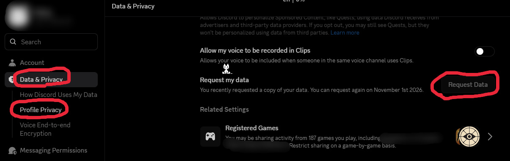
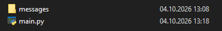
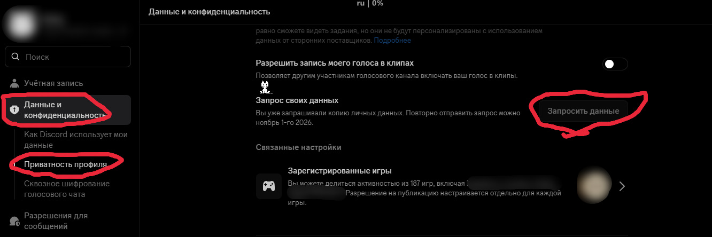

# english

## dmwipe

a script that finds closed direct messages on your discord account and deletes your messages in them

### how it works

discord doesn't expose closed dms through the api, so the script takes the list of conversations from your data package, which you can request in account settings. then it compares that list with your open dms and cleans the ones that are closed

### ⚠ warning

the script uses a user token, not a bot token, which violates discord's terms of service, your account may get banned. use at your own risk

### installation

1. request your data package in discord: settings -> privacy & safety -> request my data



2. unpack the archive and put the `messages` folder next to `main.py`



3. install dependencies:

```
pip install discord.py-self
```

4. put your token into `main.py`

### usage

```
python main.py
```

there is a 2-4 second pause between deletions to avoid discord rate limits (however if you still hit them, close the script, wait about 20 seconds and run it again)

### features

- finds closed dms using the data package
- shows the names of the people you talked to
- deletes only your own messages
- prints the total number of deleted messages at the end

[back to top](#english) | [русский](#русский)

# русский

## dmwipe

скрипт, который находит закрытые личные сообщения в твоём дс аккаунте и удаляет в них твои соо

### как работает

дс не отдаёт закрытые лички через апи, поэтому скрипт берёт список диалогов из пакета данных, который можно запросить в настройках аккаунта. дальше он сравнивает его с открытыми личками и чистит те, что закрыты

### ⚠ важно

скрипт использует токен пользователя, а не бота, что нарушает условия использования дискорда, аккаунт могут заблокировать. используйте на свой страх и риск

### установка

1. запроси пакет данных в discord: настройки -> конфиденциальность и безопасность -> запросить мои данные



2. распакуй архив и положи папку `messages` рядом с `main.py`


3. установи зависимости:

```
pip install discord.py-self
```

4. вставь свой токен в `main.py`

### запуск

```
python main.py
```

между удалением соо стоит пауза 2-4 секунды, чтобы не словить лимиты дса (однако если вдруг словите, закройте скрипт, подождите +-20 секунд, и запустите его снова)

### что делает

- ищет закрытые лички по пакету данных
- показывает имена собеседников
- удаляет только твои сообщения
- в конце пишет, сколько всего удалено

[наверх](#русский) | [english](#english)
